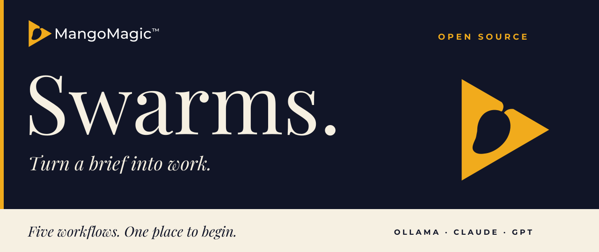

<picture>
  <source media="(max-width: 600px)" srcset="toolkit/assets/banner-mobile.svg">
  
</picture>

**A clear goal in. Useful files out.** MangoMagic Swarms brings a planner,
workers and a fresh reviewer to a focused piece of work. Choose your models,
provide a short brief, and inspect the result before putting it to use.

[**Get started**](#get-started) · [**Choose a swarm**](#choose-a-swarm) · [**Explore 200 use cases**](use-cases/README.md)

Open source · MIT licensed · macOS, Windows and Linux

<a id="choose-a-swarm"></a>
## Five ways to work.

- **Local throughout** · `swarm-ollama`<br>
  Ollama plans, writes and reviews with your installed model.
- **Claude + local workers** · `swarm-ollama-claude`<br>
  Claude Code plans and reviews. Ollama writes.
- **GPT + local workers** · `swarm-ollama-gpt`<br>
  Codex plans and reviews. Ollama writes.
- **GPT throughout** · `swarm-gpt`<br>
  Codex handles every stage. No Ollama dependency.
- **Claude throughout** · `swarm-claude`<br>
  Claude Code handles every stage. No Ollama dependency.

Choose the tools you already use. These are provider combinations, not quality
rankings. A fully local inference path requires a verified local Ollama model.
[Compare requirements and costs →](toolkit/docs/setup.md#provider-preparation)

## Get started.

You need **Git and Python 3.9+**, plus the provider tools for your chosen mode.
The installer creates all five launchers in `toolkit/bin/`. No Python packages
or provider downloads are required by the installer.

**macOS / Linux**

```sh
git clone https://github.com/mango-magic/mango-swarms.git
cd mango-swarms/toolkit
bash install.sh
./bin/swarm-gpt --dry-run
```

**Windows PowerShell**

```powershell
git clone https://github.com/mango-magic/mango-swarms.git
cd mango-swarms/toolkit
.\install.cmd
.\bin\swarm-gpt.cmd --dry-run
```

The dry run shows the selected roles without calling a model. Replace
`swarm-gpt` with your chosen command, then use `--doctor` to check its setup.
[Provider installation, login and troubleshooting →](toolkit/docs/setup.md)

## Make something useful.

Create a folder called `launch-draft` next to this clone. Save a short product
brief in it as `brief.md`: audience, approved facts, offer and unanswered questions.
Then ask for a focused deliverable:

```sh
./bin/swarm-claude ../../launch-draft --context brief.md --max-tasks 1 \
  -g "Use brief.md to draft launch-faq.md: six concise questions and answers. Use only supplied facts. Mark missing answers for review."
```

On Windows, start the same command with `.\bin\swarm-claude.cmd` and put it on
one line. The result is **staged in the private run folder** shown in Terminal.
Read the files, check the facts, and decide what to use. The source brief stays
in place. [Walk through inputs, staged files and optional checks →](toolkit/docs/running-a-use-case.md)

## 200 starting points.

A practical library across **20 functions and industries**. Every entry gives
you the required inputs, a starter prompt, concrete outputs, a suitable mode and
checks before use.

- [Map marketing claims to evidence](use-cases/marketing.md#uc-001).
- [Draft tests for a pure function](use-cases/software.md#uc-062).
- [Prepare a shift handover](use-cases/operations.md#uc-101).
- [Calibrate a marking rubric](use-cases/education.md#uc-151).
- [Document menu provenance](use-cases/hospitality.md#uc-181).

[**Browse all 200 use cases →**](use-cases/README.md)

## Built for work you can inspect.

Models receive your goal and the UTF-8 files you explicitly select. They produce
text artifacts; they do not browse, access your apps, send messages or deploy.
Applying files and running user-authored checks are separate, explicit options.
A model review is an assessment, not a passing test.

The source is free. Cloud modes use your existing provider allowance; account
settings may permit paid extra usage. Local inference uses your hardware.
There is no automatic paid fallback. [Security boundaries →](.github/SECURITY.md)

[Measured validation](toolkit/docs/validation.md) · [Performance and limits](toolkit/docs/performance.md) · [Measure your own results](toolkit/docs/measuring-results.md)

---

[Toolkit and upgrade notes](toolkit/README.md) · [Architecture](toolkit/docs/architecture.md) · [Runnable example](toolkit/examples/README.md) · [Contributing](.github/CONTRIBUTING.md) · [MIT licence](LICENSE) · [Notices](toolkit/NOTICE.md)

Built by [MangoMagic](https://github.com/mango-magic). Bring a useful brief. Leave with work you can review.
