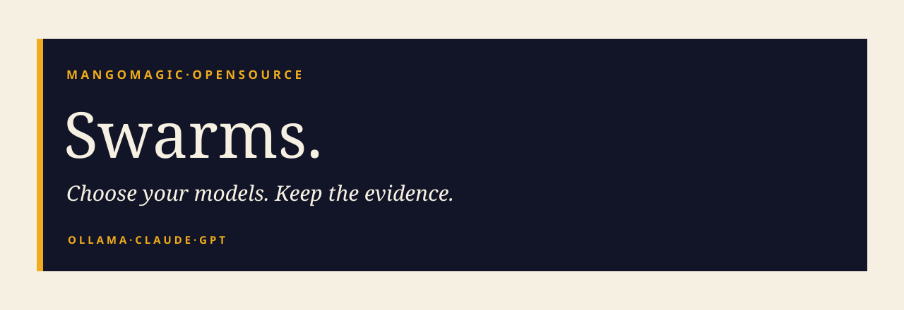

[](https://github.com/mango-magic/mango-swarms/actions/workflows/ci.yml)
[](LICENSE)

Five open-source AI workflows in one clone. Each one plans a goal, assigns
independent writing tasks, reviews the results, and stages concrete files.
Opt in to apply the files and run your own verification commands.

**Free source. Your choice of models. Clear evidence.** Model subscriptions,
cloud credits and API services are separate costs. Local inference uses your
hardware and electricity.

| Command | Planner | Workers | Independent reviewer |
| --- | --- | --- | --- |
| `swarm-ollama` | Ollama | Ollama | Ollama |
| `swarm-ollama-claude` | Claude Code | Ollama | Claude Code |
| `swarm-ollama-gpt` | Codex / GPT | Ollama | Codex / GPT |
| `swarm-gpt` | Codex / GPT | Codex / GPT | Codex / GPT |
| `swarm-claude` | Claude Code | Claude Code | Claude Code |

These are separate provider combinations, not renamed copies of one command.
Each stage makes its own bounded model request. The toolkit owns orchestration;
it does not rely on an undocumented desktop or Dot API.

The first command is spelled **`swarm-ollama`**. All five names use lowercase
`swarm-`, including the Claude and GPT combinations.

## Clone once. Build all five.

Requirements: Git and Python 3.9+. The setup creates a local Python environment
and five launchers. It needs no Python packages or network downloads.

**macOS / Linux**

```sh
git clone https://github.com/mango-magic/mango-swarms.git
cd mango-swarms
bash install.sh
./bin/swarm-ollama --doctor
```

**Windows PowerShell**

```powershell
git clone https://github.com/mango-magic/mango-swarms.git
cd mango-swarms
.\install.ps1
.\bin\swarm-ollama.cmd --doctor
```

If your PowerShell policy blocks scripts, use `.\install.cmd` or
`py -3 scripts/install.py`. Do not change the execution policy for this toolkit.

Install and sign in to the provider tools you choose separately. The diagnostic
explains missing dependencies. Nothing purchases a subscription, creates a key,
downloads a model, or changes global permissions.

- Ollama modes need [Ollama](https://ollama.com/download) running with an installed
  model. The default model is `qwen3:8b`; use `--ollama-model NAME` to select another.
- GPT modes need the [official Codex CLI](https://developers.openai.com/codex/cli)
  and its existing ChatGPT login.
- Claude modes need [Claude Code](https://code.claude.com/docs/en/setup) and an
  existing Claude subscription login.

`swarm-claude` uses Claude Code for every stage. It requires neither Ollama nor
Codex. Run `./bin/swarm-claude --doctor` to check only its Claude dependency.

See [setup and authentication](docs/setup.md) for platform details.

## Give it a bounded goal.

```sh
./bin/swarm-ollama ./my-project \
  -g "Create a concise launch checklist in launch-checklist.md"

./bin/swarm-ollama-claude ./my-project \
  --context brief.md -g "Write a landing-page draft and FAQ from this brief"

./bin/swarm-ollama-gpt ./my-project \
  --context requirements.md -g "Implement the specified small Python module"

./bin/swarm-gpt ./my-project \
  -g "Create a small CSV validation utility with usage documentation"

./bin/swarm-claude ./my-project \
  --context requirements.md -g "Implement the specified small Python module"
```

On Windows, use `.\bin\<command>.cmd`. The arguments are the same.
All generated text is staged under the private run directory shown in Terminal.
The models receive only your goal and the text files you explicitly select with
`--context`. They do not browse your disk or run shell commands.

To apply approved artifacts and run a verifier you wrote:

```sh
./bin/swarm-ollama-gpt ./my-project \
  --context requirements.md \
  -g "Implement the specified small Python module" \
  --apply --check-file checks.json
```

`checks.json` contains argument arrays, not shell strings:

```json
[
  ["{python}", "-m", "unittest", "discover", "-s", "tests", "-v"]
]
```

Only use checks you understand. `--apply --check-file` authorizes those commands
to run on your machine. A model review is not a passing test.

## Predictable boundaries.

- Default: up to three planned tasks, two worker slots, one shared Ollama
  request across workflows using the same state directory.
- `-n` controls worker slots, not Ollama server parallelism.
- One workflow per target folder at a time; separate folders may run independently.
- Existing files are replaced only if explicitly selected as context and unchanged
  since the run began. Original bytes are backed up in private state.
- No full-access flags, automatic paid fallback, unlimited loops or remote shell.
- API-key billing is deliberately not supported by the GPT/Claude adapters in v0.1.
- The cloud planner/reviewer sees selected context and generated artifacts.
  Use `swarm-ollama` with a verified local model for a fully local inference path.

This release is a **bounded artifact workflow**, not an unrestricted autonomous
computer operator. It is useful for drafts, small code changes and concrete
deliverables. It does not promise 150 staff-equivalents or a hardware-independent
number of parallel agents.

## What can a 24 GB Mac run?

Start with **one active local generation**, an 8B quantized model and 8K context.
Measure before increasing workload size. Ten open workflow processes can wait
on the shared inference gate; they are not ten simultaneous local generations.
Queues may time out under sustained load.

See [performance, model sizes and benchmarking](docs/performance.md) for explicit
starting profiles, measured-versus-estimated distinctions, and memory tradeoffs.
See [validation status](docs/validation.md) for exactly what has been tested.

```sh
./bin/swarm-ollama --ollama-model qwen3:8b --benchmark 3
./bin/swarm-gpt --dry-run
```

The benchmark uses a synthetic correctness-checked prompt. It measures latency,
not business productivity. Cloud benchmarks consume provider allowance.

## Explore.

- [Architecture and state](docs/architecture.md)
- [Setup and authentication](docs/setup.md)
- [Performance and practical limits](docs/performance.md)
- [Examples](examples/README.md)
- [Security boundaries](SECURITY.md)
- [Contributing](CONTRIBUTING.md)
- [MIT licence](LICENSE) and [third-party notice](NOTICE.md)

Built by [MangoMagic](https://github.com/mango-magic). Fork it, improve it, and
share measured results.
