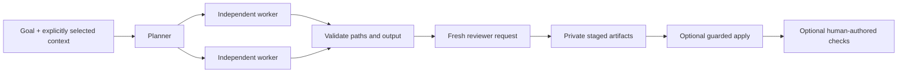

# Architecture and state.



The mode selects actual adapters for planning, work and review. Ollama uses its
documented `/api/chat` interface with a JSON schema, streaming disabled and
bounded context/output settings. GPT uses `codex exec` with structured output,
read-only sandboxing, disabled tools/plugins and existing ChatGPT authentication.
Claude uses its documented print/JSON-schema interface with tools disabled and
safe mode. No vendor binaries are bundled.

Each worker has a separate task prompt. The reviewer sees all proposed text in
a fresh request and can reject the result. The orchestrator validates result
shape and portable paths, then stages text artifacts. It does not execute
model-generated tool calls. A review is an assessment, not proof of correctness.

The default is at most three tasks and two worker threads. Ollama requests share
one OS file lock across all processes using the same state home. Thus two worker
threads or ten workflow processes can queue while one Ollama request generates.
This gate limits this toolkit's requests only, not other programs using Ollama.
It does not change `OLLAMA_NUM_PARALLEL`, loaded-model settings or server policy.

Workspaces have separate locks independent of provider mode. This prevents two
toolkit runs from applying to the same resolved folder simultaneously. It cannot
lock out an editor or unrelated program. Files are checked again before writing;
there remains a small filesystem race if an external program edits at the same
instant. Avoid concurrent editing during `--apply`.

## Run state.

Default locations:

- macOS: `~/Library/Application Support/MangoMagic/swarms`
- Windows: `%LOCALAPPDATA%\MangoMagic\swarms`
- Linux: `$XDG_STATE_HOME/MangoMagic/swarms`, or `~/.local/state/MangoMagic/swarms`

`MANGO_SWARMS_HOME` overrides that location. Do not place private runtime state
inside a public source repository.

```text
jobs/<workspace-hash>/
  goal.txt
  LATEST
  runs/<time-and-id>/
    GOAL.md
    plan.json
    worker-<task>.json
    review.json
    report.json
    *-metrics.json
    artifacts/
    backups/
locks/
benchmarks/
```

State contains private goals, generated text and selected-file backups. POSIX
files use a restrictive umask; Windows uses the user's inherited filesystem ACL.
No user names, prompts, context, model responses or runtime paths are sent as
toolkit telemetry. Providers receive the prompts needed for the selected mode
under their own terms.

## Result meanings.

| Status | Meaning |
| --- | --- |
| `staged` | Reviewer approved; files are ready for human inspection |
| `needs_review` | Reviewer found issues; workspace not changed |
| `applied_unverified` | Files applied, but no executable checks were supplied |
| `verified` | Applied and every supplied check exited zero |
| `check_failed` | Applied files remain; a check failed |
| `failed` | Provider, path, context, queue or application failure |
| `interrupted` | Run interrupted; inspect its report before restarting |

Exit `0` means the selected stage/apply/check workflow succeeded. It does not
always mean tests ran. Exit `3` means review rejection or failed checks; exit `1`
is another error; Ctrl+C returns `130`.

Calls and queue waits have timeouts. There is no endless retry or keep-alive
loop. An in-flight Ollama HTTP request may continue until its response/timeout
after interruption; worker threads are joined before process exit. CLI child
process trees are terminated when their request times out.

## Lineage.

The toolkit generalises a conductor/worker/reviewer workflow into original
portable code. Private launcher scripts, secret-store lookups, personal models,
provider-switching heuristics and broad permission flags are not distributed.
This public `swarm-gpt` is a portable staged workflow; an independently installed
native-agent launcher of the same name is not modified or silently replaced.
